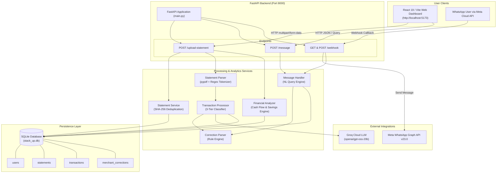

# Stack Up — Comprehensive Codebase Analysis

## 1. Executive Summary

**Stack Up** is an AI-powered personal finance management platform tailored primarily for Indian bank statements and UPI-driven financial activity. The system extracts transaction histories from PDF bank statements, categorizes them using a layered hybrid approach (User Overrides $\rightarrow$ Deterministic Rules $\rightarrow$ Groq LLM Inference), calculates key financial metrics (Net Cash Flow, Income, Expenses, Savings Rate, Category Totals), and exposes these insights through:

1. **A modern single-page React Web Dashboard** (Vite + React 19 + Lucide Icons) with interactive analytics, transaction tables, statement upload, and a conversational financial assistant ("Ask Stack Up").
2. **A WhatsApp Cloud API Bot** allowing users to query expenses, view spending summaries, and dynamically correct merchant categories directly over chat.

---

## 2. System Architecture & Component Diagram



---

## 3. Directory & File Structure

```
stack up/
├── backend/
│   ├── __init__.py
│   └── main.py                     # FastAPI routes, CORS, WhatsApp webhook, file upload
├── database/
│   ├── __init__.py
│   ├── database.py                 # SQLite schema, queries, atomic statement replace
│   └── corrections.py              # Merchant category override database operations
├── frontend/
│   ├── public/                     # Static assets (favicons, SVG icons)
│   ├── src/
│   │   ├── assets/                 # SVGs and graphics
│   │   ├── App.css                 # Custom responsive design & dark-themed dashboard UI
│   │   ├── App.jsx                 # Single-page React dashboard & chat assistant
│   │   ├── index.css               # Base CSS resets & variables
│   │   └── main.jsx                # React DOM mount point
│   ├── index.html                  # HTML entry point
│   ├── package.json                # React 19, Vite, Lucide React, Recharts
│   └── vite.config.js              # Vite React configuration
├── services/
│   ├── __init__.py
│   ├── ai_assistant.py             # Groq LLM client (openai/gpt-oss-20b) with batching & retries
│   ├── analyzer.py                 # Income, expense, cash flow, savings rate calculator
│   ├── categorizer.py              # Standalone rule-based & AI categorizer (earlier iteration)
│   ├── correction_parser.py        # Natural language merchant correction parser
│   ├── message_handler.py          # Chatbot intent router for WhatsApp & Web UI
│   ├── statement_parser.py         # PDF text extraction, row segmenting & delta reconciliation
│   ├── statement_service.py        # SHA-256 deduplication and statement registration
│   ├── transaction_processor.py    # Multi-tier classification orchestrator
│   └── transaction_query.py        # Financial querying utilities (category sums, totals, counts)
├── tests/                          # Test directory (scaffolded)
├── utils/                          # Utility functions (scaffolded)
├── full_test.py                    # Offline end-to-end PDF parsing and categorization tester
├── test_parser.py                  # Standalone statement parser test script
├── stack_up.db                     # Primary SQLite database file
├── requirements.txt                # Python dependencies (currently unpopulated)
└── .env                            # Environment configurations (API keys & tokens)
```

---

## 4. Database Schema Deep Dive (`stack_up.db`)

The database uses SQLite 3 with parameter-bound SQL queries:

### 1. `users`
| Column | Type | Constraints | Description |
| :--- | :--- | :--- | :--- |
| `id` | INTEGER | PRIMARY KEY AUTOINCREMENT | Internal user identifier |
| `user_id` | TEXT | UNIQUE NOT NULL | External user identifier (e.g. phone number or "demo-user") |
| `created_at` | TIMESTAMP | DEFAULT CURRENT_TIMESTAMP | Registration timestamp |

### 2. `statements`
| Column | Type | Constraints | Description |
| :--- | :--- | :--- | :--- |
| `id` | INTEGER | PRIMARY KEY AUTOINCREMENT | Internal statement ID |
| `user_id` | TEXT | NOT NULL | Owner user reference |
| `file_hash` | TEXT | NOT NULL | SHA-256 cryptographic digest of statement PDF |
| `filename` | TEXT | | Original uploaded file name |
| `created_at` | TIMESTAMP | DEFAULT CURRENT_TIMESTAMP | Upload timestamp |
| *Constraint* | | `UNIQUE(user_id, file_hash)` | Prevents duplicate statement uploads per user |

### 3. `transactions`
| Column | Type | Constraints | Description |
| :--- | :--- | :--- | :--- |
| `id` | INTEGER | PRIMARY KEY AUTOINCREMENT | Transaction record ID |
| `user_id` | TEXT | NOT NULL | User reference |
| `statement_id` | INTEGER | | Foreign reference to `statements.id` |
| `transaction_number` | INTEGER | | Sequence number in original bank statement |
| `date` | TEXT | | Normalized transaction date |
| `description` | TEXT | | Cleaned narration / merchant text |
| `reference` | TEXT | | Reference number (e.g. UPI, IMPS, NEFT) |
| `amount` | REAL | | Positive monetary value |
| `type` | TEXT | | Bank direction: `"credit"` or `"debit"` |
| `balance` | REAL | | Running balance after transaction |
| `category` | TEXT | | Assigned category (e.g. Food, Shopping, Transfer) |
| `transaction_type` | TEXT | | High-level type: `"income"`, `"expense"`, `"transfer"`, `"unknown"` |
| `created_at` | TIMESTAMP | DEFAULT CURRENT_TIMESTAMP | Record insertion time |

### 4. `merchant_corrections`
| Column | Type | Constraints | Description |
| :--- | :--- | :--- | :--- |
| `id` | INTEGER | PRIMARY KEY AUTOINCREMENT | Correction ID |
| `user_id` | TEXT | NOT NULL | User reference |
| `merchant` | TEXT | NOT NULL | Target merchant substring (e.g., "zomato") |
| `category` | TEXT | NOT NULL | Target category name |
| `created_at` | TIMESTAMP | DEFAULT CURRENT_TIMESTAMP | Timestamp |
| *Constraint* | | `UNIQUE(user_id, merchant)` | UPSERT replaces previous assignment |

---

## 5. Core Pipelines & Business Logic

### A. PDF Statement Ingestion Pipeline
1. **Deduplication Check (`statement_service.py`)**: Computes SHA-256 hash of the binary file stream. If the hash exists for this `user_id` and `reprocess=False`, returns saved records instantly without re-running OCR or LLMs.
2. **Text Extraction (`statement_parser.py`)**: Uses `pypdf.PdfReader` to aggregate multi-page plain text.
3. **Opening Balance Detection**: Searches for `Opening Balance` lines and extracts the baseline running balance.
4. **Transaction Segmentation**:
   - Matches rows starting with an integer followed by valid date formats (`DD Mon YYYY`, `DD/MM/YYYY`, etc.).
   - Parses monetary values using regular expression `MONEY_PATTERN`.
   - Extracts reference numbers (`UPI`, `IMPS`, `NEFT`).
5. **Balance Delta Direction Classification**:
   - Reconciles $\Delta = \text{Balance} - \text{Previous Balance}$.
   - If $\Delta > 0$ and $|\Delta - \text{Amount}| \le 0.01$, marks transaction as `credit`.
   - If $\Delta < 0$ and $|\Delta - (-\text{Amount})| \le 0.01$, marks transaction as `debit`.
   - Protects against ambiguous bank layouts where credit/debit columns might be misaligned.

### B. 3-Tier Categorization Engine (`transaction_processor.py`)
```
               [ Transaction In ]
                        │
                        ▼
           Tier 1: User Corrections Table
        (Is merchant in merchant_corrections?)
                   ├── YES ──► Assign User Category
                   └── NO
                        │
                        ▼
           Tier 2: Rule-Based Classifier
           (Keyword match in description?)
                   ├── YES ──► Assign Keyword Category
                   └── NO
                        │
                        ▼
           Tier 3: Groq LLM Inference (openai/gpt-oss-20b)
        (Batches of 5; temperature=0; JSON array output)
                   ├── SUCCESS ──► Sanity Check against Bank Direction
                   └── FAILURE ──► Fallback to "Other" / "unknown"
```
- **Integrity Enforcement**: Debits cannot be forced into `income`, and credits cannot be forced into debit expenses.
- **Transfers vs UPI Purchases**: UPI payments are not blindly marked as `transfer`; explicit transfer keywords (`self transfer`, `fund transfer`, `own account`) are required.

### C. Financial Analysis Engine (`analyzer.py`)
Computes aggregate metrics:
- $\text{Total Income} = \sum \text{Amount}_{\text{type}=\text{income}}$
- $\text{Total Expenses} = \sum \text{Amount}_{\text{type}=\text{expense}}$
- $\text{Net Cash Flow} = \text{Total Income} - \text{Total Expenses}$
- $\text{Savings Rate} = \frac{\text{Net Cash Flow}}{\text{Total Income}} \times 100\%$ (handled safely if Income is 0)
- Transfers are segregated into `total_transfer_in` and `total_transfer_out` to avoid distorting real expenses.

### D. Natural Language Query Engine (`message_handler.py`)
Accepts text from both Web Chat and WhatsApp:
- **Merchant Correction**: Matches `change <merchant> to <category>` $\rightarrow$ updates `merchant_corrections`.
- **Predefined Financial Intents**:
  - Highest spending category (`"where am i spending the most"`)
  - Transaction counts (`"how many transactions"`)
  - Total income / earnings (`"total income"`)
  - Total expenses / spending (`"total expenses"`)
  - Transfer volumes (`"total transfers"`)
  - Category-specific spending (`"how much on food"`)
  - Spending summaries and savings opportunities

---

## 6. Frontend Architecture (`frontend/src/App.jsx`)

The frontend is a single-page application built on Vite and React 19:
- **Navigation Views**:
  - `Dashboard`: KPI metric cards, spending progress bars, recent transaction table, and statement upload CTA.
  - `Transactions`: Complete searchable tabular view with credit/debit badges and category pills.
  - `Analytics`: High-level spending insights and cash-flow breakdown.
  - `Ask Stack Up`: Real-time chat assistant connected to backend `/message` route, with quick-prompt chips.
- **State Management**:
  - Local React state (`transactions`, `analysis`, `activePage`, `messages`, `uploading`, `asking`).
  - Formats currency into Indian Rupee (`en-IN`, `INR`) with zero fraction formatting.

---

## 7. Key Findings & Strengths

1. **Zero-Hallucination Guardrails**: The LLM output is post-processed and validated against hard bank accounting balances, preventing the LLM from classifying bank debits as income.
2. **Idempotent Ingestion**: SHA-256 statement fingerprinting avoids repeated costly PDF OCR/parsing and LLM token usage on accidental re-uploads.
3. **Atomic State Updates**: `replace_statement_transactions` uses SQLite transaction blocks to prevent corrupt or partial transaction states.
4. **Dual Interface**: Seamless support for both a web dashboard and an asynchronous WhatsApp webhook handler.

---

## 8. Areas for Improvement & Recommendations

| Priority | Issue / Opportunity | Recommended Action |
| :--- | :--- | :--- |
| **High** | Empty `requirements.txt` | Populate `requirements.txt` with `fastapi`, `uvicorn`, `pypdf`, `groq`, `python-dotenv`, etc. |
| **High** | Temporary File Management | Replace `temp_{filename}` in `backend/main.py` with Python's standard `tempfile.NamedTemporaryFile` to prevent orphaned files. |
| **Medium** | Redundant Categorizer | `services/categorizer.py` duplicates `services/transaction_processor.py`. Deprecate or remove `categorizer.py` to maintain a single source of truth. |
| **Medium** | Recharts Integration | `recharts` is installed in `package.json` but unused in `App.jsx`. Visual bar/pie charts can replace static CSS bars. |
| **Medium** | Conversational LLM in Chat | Connect `message_handler.py` to Groq LLM for complex queries not covered by keyword rules. |
| **Low** | Tests & Utils Scaffolding | Implement unit tests in `tests/` for `statement_parser.py` and `analyzer.py`. |
